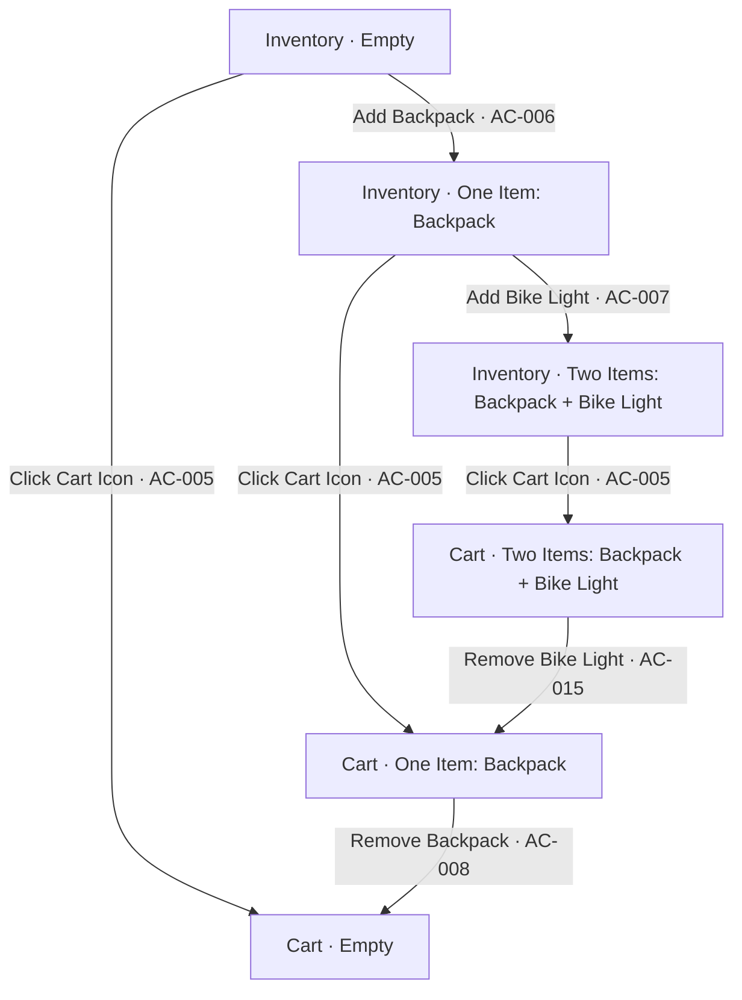

# SauceDemo — Decision Tables and State Transition Design

**Assessment date:** 2026-11-19  
**Test object:** https://www.saucedemo.com/  
**Status:** DESIGN REVIEW COMPLETE — Q1–Q6; Final Quality Gate: CONDITIONAL PASS (CP)  
**Execution status:** Manual tests executed by the Software Test Engineer; results documented in the requirements observation log. No new automation execution is claimed for these scenarios; independent screenshot review is limited.  
**Terminology:** See Section 9 for abbreviations, identifiers, and result labels.  
**Test basis:** [requirements.md](requirements.md) (AC-001–017; exercise-level PO approval); [design-techniques.md](design-techniques.md) (18 Nov EP/BVA report); [scope.md](scope.md) (16 Nov automation baseline). GitHub versions may differ from these local deliverables.

## 1. Objective and scope

Design condition/action rules for Cart and Checkout Information and state transitions for the cart-to-completion flow. This is a design artifact with a summarized manual-execution record, not a formal test execution log. Rules derived from exercise ACs and manual test results recorded by the Software Test Engineer are candidate expectations, not official SauceDemo product requirements. Candidate TC IDs are traceability placeholders, **not existing test-case IDs**.

## 2. DT-001 — Cart Decision Table

| Condition / action / expected result | R01 | R02 | R03 | R04 |
|---|---|---|---|---|
| Initial cart state | Empty | One Backpack | Two items: Backpack + Bike Light | One Backpack |
| Starting page | Inventory | Inventory | Cart | Cart |
| Action | Add Backpack | Add Bike Light | Remove Bike Light | Remove Backpack |
| Expected cart item count | 1 | 2 | 1 | 0 |
| Expected badge | `1` | `2` | `1` | No numeric badge; cart icon remains |
| Expected page | Inventory | Inventory | Cart | Cart |
| Related AC | AC-006 | AC-007 | AC-015 | AC-008 |
| Proposed TC ID | TC-001 | TC-002 | TC-003 | TC-004 |

**Rule design status:** R01–R04 design answers reviewed (Q2/6: PASS). These rules represent expected results. The user also reported manual cart interactions; those observations are not included as a separate evidence-status field or formal execution verdict in this design table.

**Specification update:** The exercise PO approved AC-015 (two-to-one removal), AC-016 (block checkout with an empty cart), and AC-017 (one instance per product). AC-016 failed manual testing; AC-017 passed. Three-or-more-product behavior remains unverified. The cart-link navigation AC-005 is covered in the transition table, not counted as one of these four Add/Remove rules.

## 3. Combined cart state-transition model (Q3/6: PASS)

Each state is a pair **(page, cart contents/count)**. `Inventory → Cart` changes the page but not the cart contents. Product removal is modeled on **Cart**, not Inventory. `Empty`, `One Item`, and `Two Items` are exercise states, **not a claimed maximum cart capacity**.

| Transition | From | Trigger | To | Expected observation | Related AC | Proposed TC |
|---|---|---|---|---|---|---|
| ST-01 | Inventory, Empty | Add Backpack | Inventory, One Item (Backpack) | Badge `1`; Backpack added | AC-006 | TC-001 |
| ST-02 | Inventory, One Item (Backpack) | Add Bike Light | Inventory, Two Items (Backpack + Bike Light) | Badge `2`; both items present | AC-007 | TC-002 |
| ST-03 | Cart, Two Items (Backpack + Bike Light) | Remove Bike Light | Cart, One Item (Backpack) | Badge `1`; Bike Light absent | AC-015 — exercise PO approved | TC-003 |
| ST-04 | Cart, One Item (Backpack) | Remove Backpack | Cart, Empty | No cart rows or numeric badge; cart icon remains | AC-008 | TC-004 |
| ST-05 | Inventory, Empty | Click Cart Icon | Cart, Empty | `cart.html`; `Your Cart` heading | AC-005 | TC-005 |
| ST-06 | Inventory, One Item | Click Cart Icon | Cart, One Item | `cart.html`; `Your Cart` heading; item retained | AC-005 | TC-006 |
| ST-07 | Inventory, Two Items | Click Cart Icon | Cart, Two Items | `cart.html`; `Your Cart` heading; items retained | AC-005 | TC-007 |

**Coverage interpretation:** ST-03 was designed and manually exercised according to the user's report. The exercise PO subsequently approved **AC-015** for the exact two-to-one removal behavior. AC-015 is recorded in the accompanying local `requirements.md`. AC-006 is related only by the resulting one-item state and must not be misrepresented as direct requirement coverage. ST-05–ST-07 are three variants of the same AC-005 navigation requirement. Separate manual execution evidence for all three navigation variants has **not** been established.

**Q3 verification:** PASS — seven distinct modeled transitions, with correct page/action separation and AC traceability or an explicit gap. **Q3 validation:** PASS for exercise design acceptance; manual execution was recorded by the Software Test Engineer, without an independent replay. The diagram is a selected scenario model, not a complete state machine for all possible items and actions.

## 4. DT-002 — Checkout Information Decision Table (Q4/6: PASS)

Conditions: F = First Name nonempty; L = Last Name nonempty; P = Postal Code nonempty. The observed UI reports the **first missing field in F → L → P order**. Exact messages are observations from the 17–18 November review, not official product requirements.

| Rule | F | L | P | Expected first response on Continue | AC | Proposed TC |
|---|---|---|---|---|---|---|
| R01 | Y | Y | Y | Advance to Checkout Overview | AC-011 | TC-CHK-001 |
| R02 | N | Y | Y | `Error: First Name is required`; remain on Information | AC-012 | TC-CHK-002 |
| R03 | Y | N | Y | `Error: Last Name is required`; remain on Information | AC-012 | TC-CHK-003 |
| R04 | Y | Y | N | `Error: Postal Code is required`; remain on Information | AC-012 | TC-CHK-004 |
| R05 | N | N | Y | `Error: First Name is required`; remain on Information | AC-012 | TC-CHK-005 |
| R06 | N | Y | N | `Error: First Name is required`; remain on Information | AC-012 | TC-CHK-006 |
| R07 | Y | N | N | `Error: Last Name is required`; remain on Information | AC-012 | TC-CHK-007 |
| R08 | N | N | N | `Error: First Name is required`; remain on Information | AC-012 | TC-CHK-008 |

**Q4 design review:** PASS — all eight distinct F/L/P combinations were answered by the user on 19 November 2026, including error-message priority and the successful Overview transition. AC-011 maps to R01; AC-012 maps to R02–R08. Candidate TC-CHK-001–008 are proposed IDs, not evidence of executed tests. The 17–18 November manual observations are the stated basis for exact error text; the 19 November answers are design review, not new AUT executions.

**Design limitation:** “Nonempty” is the supported partition. Input length, character-set, numeric-postal-code and whitespace-only rules are not specified; no additional outcome is asserted for them.

## 5. Checkout state transitions (Q5/6: PASS — reported observations)

| Transition | From | Trigger / guard | To | Expected observation | AC | Proposed TC |
|---|---|---|---|---|---|---|
| CHST-01 | Cart with one product | Select Checkout | Checkout Information | `checkout-step-one.html`, `Checkout: Your Information` | AC-009 | TC-CHK-009 |
| CHST-02 | Cart with two products | Select Checkout | Checkout Information | `checkout-step-one.html`, `Checkout: Your Information` | AC-010 | TC-CHK-010 |
| CHST-03 | Checkout Information | Continue; all three fields nonempty | Checkout Overview | `checkout-step-two.html`; `Checkout: Overview` | AC-011 | TC-CHK-001 |
| CHST-04 | Checkout Information | Continue; any required field empty | Checkout Information | `checkout-step-one.html` retained; first missing-field error in F → L → P order (seven cases); no advancement | AC-012 | TC-CHK-002–008 |
| CHST-05 | Checkout Overview | Review items and totals | Checkout Overview | Items/quantities and subtotal/tax/total visible; displayed arithmetic consistent | AC-013 | TC-CHK-011 |
| CHST-06 | Checkout Overview | Select Finish | Checkout Complete | `checkout-complete.html`; `Checkout: Complete!`; `Thank you for your order!` and dispatch explanation | AC-014 | TC-CHK-012 |

**Q5 review evidence:** On 19 November 2026, the user confirmed CHST-01 and CHST-02 URL/title and AC-009/010; CHST-03 URL/title and AC-011; CHST-04 same-page error behavior across the seven Q4 combinations and AC-012; and Finish navigation to `checkout-complete.html`, title `Checkout: Complete!`, confirmation `Thank you for your order!`, and dispatch text for **CHST-06 / AC-014**. CHST-05 is a review/observation self-loop, not a Finish transition; its detailed item/totals evidence is recorded in `requirements.md` (17 November) rather than newly executed in Q5. The conversation previously called Finish “CHST-05”; that was an **identifier error**. The stable document identifier is **CHST-06**, and AC-014 remains unchanged. These are manual test results recorded by the Software Test Engineer, not independent AUT verification or formal TC execution.

**Open conditions:** Empty-cart Checkout is now covered by AC-016 and is a manual FAIL. Duplicate addition is covered by AC-017 and is a manual PASS. Three-or-more-item behavior, cancellation/back navigation, nonempty malformed data and checkout recovery after errors remain unverified.

## 5A. DT-003 — Newly approved cart policy checks (19 November)

| Rule | Starting condition | Action | Exercise PO expected result | Actual manual result | AC | Verdict | Proposed TC |
|---|---|---|---|---|---|---|---|
| E01 | Cart contains zero items | Select Checkout | Remain on Cart; checkout blocked | Navigated to `checkout-step-one.html`; a separate Overview screenshot shows zero totals, but does not independently establish its navigation path | AC-016 | FAIL — defect candidate | TC-CHK-013 |
| D01 | One instance of a product already in cart | Attempt to add the same product again | Only one instance remains; quantity `1` | Product was not added a second time | AC-017 | PASS — manual | TC-008 |

**State-transition additions:**

| Transition | From | Trigger | Expected destination | Actual | AC | Verdict |
|---|---|---|---|---|---|---|
| CHST-07 | Cart, Empty | Select Checkout | Cart, Empty (blocked) | Checkout Information (`checkout-step-one.html`) | AC-016 | FAIL |
| ST-08 | Inventory/cart, product already added | Attempt same product addition | Cart retains one instance | No second instance added; exact UI sequence not recorded | AC-017 | PASS — manual |

**Triage note:** AC-016/017 are training-exercise PO decisions, not independently established official SauceDemo requirements. AC-016 is a defect candidate **relative to that exercise specification**. The screenshot of the zero-total Overview is additional evidence of the zero-value state, not proof of the complete click path. Three-or-more-product scenarios remain a residual risk, not a failed test.

## 6. Traceability and proposed test cases

| AC | Rule/transition coverage | Candidate case IDs | Formal execution |
|---|---|---|---|
| AC-005 | ST-05–ST-07 | TC-005–TC-007 | No separate formal execution record |
| AC-006 | DT-001 / R01, ST-01 | TC-001 | No separate formal execution record |
| AC-007 | DT-001 / R02, ST-02 | TC-002 | No separate formal execution record |
| AC-008 | DT-001 / R04, ST-04 | TC-004 | No separate formal execution record |
| AC-009 | CHST-01 | TC-CHK-009 | Manual execution recorded; formal TC execution not logged |
| AC-010 | CHST-02 | TC-CHK-010 | Manual execution recorded; formal TC execution not logged |
| AC-011 | DT-002 / R01, CHST-03 | TC-CHK-001 | Manual execution recorded; formal TC execution not logged |
| AC-012 | DT-002 / R02–R08, CHST-04 | TC-CHK-002–008 | Manual execution recorded; formal TC execution not logged |
| AC-013 | CHST-05 | TC-CHK-011 | Manual overview observation recorded on 17 Nov; no new Q5 execution |
| AC-014 | CHST-06 | TC-CHK-012 | Manual execution recorded; formal TC execution not logged |
| AC-015 | DT-001 / R03, ST-03 | TC-003 | Manual execution recorded; exercise PO approved; local requirements.md updated |

| AC-016 | DT-003 / E01, CHST-07 | TC-CHK-013 | Manual FAIL — empty cart navigated to Checkout Information; defect candidate against exercise PO criterion |
| AC-017 | DT-003 / D01, ST-08 | TC-008 | Manual PASS — same product not added twice; interaction details not separately captured |

## 7. Verification and Validation

| Stage | Item | Acceptance criterion | Actual result | Verdict |
|---|---|---|---|---|
| Verification | Report structure | Two decision tables, state-transition coverage, traceability | Draft contains all four design components | PASS — document structure only |
| Verification | Checkout rule completeness | Eight mutually exclusive Boolean combinations | Eight unique F/L/P combinations enumerated and checked against Q4 answers | PASS — design only |
| Verification | Checkout AC/TC traceability | Valid combination to AC-011; seven invalid combinations to AC-012; distinct proposed TC IDs | R01–R08 linked to AC-011/012 and TC-CHK-001–008 | PASS — design only |
| Validation | Q4 checkout design review | All eight answers align with F → L → P error priority and successful Overview transition | Eight user responses reviewed, 8/8 aligned | PASS — design acceptance; no new AUT run |
| Verification | Cart AC mapping | R01/R02/R04 map to AC-006/007/008; AC-005 maps to ST-05–ST-07; R03 mapped to newly approved AC-015 with synchronization status | Mappings and local requirements synchronization documented | PASS — design only |
| Validation | User review of rules | User evaluates fixed Q1–Q6 | Q1–Q6 answered; Q6 CP with residual-risk documentation | PASS — review complete |
| Verification | Q5 checkout transition mapping | Six stable CHST IDs; correct AC mappings; Finish = CHST-06 | Six IDs retained; CHST-01/02/03/04/06 linked to user reports; CHST-05 remains AC-013 review self-loop | PASS — design/traceability |
| Validation | Q5 checkout behavior | Observations align with AC-009/010/011/012/014 | Manual execution records for URLs, titles, errors and confirmation align; no independent AUT replay | PASS — reported behavior only |
| Validation | Actual AUT behavior | Repeatable test execution with evidence | Manual execution results recorded by the Software Test Engineer; screenshots are not required for an execution PASS | PASS — manual execution record; independent replay not claimed |
| Validation | Unspecified behaviors | No invented product requirements | Gaps explicitly listed | PASS — documentation scope only |

## 8. Final Quality Gate — Q6/6 (19 November 2026)

**Decision: CONDITIONAL PASS (CP).** The Software Test Engineer completed the six-question design review and performed manual checks. Manual execution is **PASS** as a completed activity; absence of distributed screenshots does not turn executed tests into NOT RUN. The existing CI baseline is historical and does not imply that new decision-table scenarios were automated.

| Quality gate | Expected | Actual | Verdict |
|---|---|---|---|
| Requirements traceability | All AC-001–017 identified and linked to a REQ | Six REQ groups; AC-001–017 in `requirements.md`; design mappings for cart/checkout | PASS — document traceability |
| Design coverage | Reviewed decision rules and transitions represented | DT-001 (4 rules), DT-002 (8 rules), DT-003 (2 targeted cases); ST-01–08 and CHST-01–07 | PASS — selected design scope |
| Manual execution | Actual manual results distinguished from design-only cases and CI | Software Test Engineer performed manual checks; AC-016 FAIL and AC-017 PASS recorded; candidate TC IDs are not formal execution logs | PASS — manual execution; record completeness varies |
| Residual risks | Unverified scenarios and product-policy limitations explicit | 3+ products, navigation recovery, input-format/length rules, backend persistence unverified; tax-rate formula source-verified on 2026-11-20 | CONDITIONAL PASS — risks documented |
| Defect triage | Failed AC has a recorded expected/actual and ownership | AC-016: checkout allowed with empty cart; defect candidate against exercise PO rule; upstream Issue #201 CLOSED as expected behaviour; exercise AC-016 remains FAIL | CLOSED upstream; historical exercise FAIL |

**Release/acceptance interpretation:** CP applies to the **test-design deliverables**, not to the application's defect-free status. AC-016 is an application FAIL against the newly approved exercise AC; no defect fix or retest is claimed. No GitHub push is implied.

## 9. Abbreviations and legend

| Term | Meaning | Usage in this document |
|---|---|---|
| AC | Acceptance Criterion | Requirement reference, e.g., `AC-006`; `MISSING` means no explicit matching AC was identified. |
| AUT | Application Under Test | SauceDemo; `NOT RUN` or `NOT VERIFIED` must not be read as an executed application test. |
| CHST | Checkout State Transition | Checkout flow transition identifier, e.g., `CHST-01`. |
| DT | Decision Table | Decision table identifier, e.g., `DT-001` (Cart) and `DT-002` (Checkout Information). |
| F / L / P | First Name / Last Name / Postal Code | Boolean input conditions in `DT-002`; `Y` = nonempty, `N` = empty. |
| ID | Identifier | Unique label for a design element or proposed test case. |
| Q | Question | Daily exercise question number, e.g., `Q4/6`. |
| CP | Conditional Pass | Design accepted with documented residual risks and a historical exercise-AC FAIL (upstream Issue #201 CLOSED — expected behaviour). |
| PO | Product Owner | ChatGPT acting as PO for this training exercise only. |
| REQ | Requirement | Candidate functional requirement group. |
| CI | Continuous Integration | Historical GitHub Actions automation baseline, not new manual execution. |
| EP / BVA | Equivalence Partitioning / Boundary Value Analysis | Techniques covered in `design-techniques.md`. |
| R | Rule | Decision-table rule number (`R01` etc.); scoped to its own DT, not globally unique. |
| ST | State Transition | Cart transition identifier, e.g., `ST-03`. |
| TC | Test Case | Proposed test-case identifier; `TC-CHK-*` is a proposed Checkout test-case series. IDs do not establish that cases were created or executed. |
| UI | User Interface | Visible page elements, labels, and error messages. |

**AC-015 — Remove one product from a multi-item cart (REQ-003; exercise PO approval on 2026-11-19):** Given the Cart page contains Sauce Labs Backpack and Sauce Labs Bike Light, when the user removes Sauce Labs Bike Light, then Bike Light is absent, Backpack remains, the numeric cart badge displays `1`, and the user remains on the Cart page. **Approval scope:** training exercise only; not official SauceDemo stakeholder approval. **Repository status:** incorporated into accompanying local `requirements.md`; no GitHub update claimed.

**Result labels:** `PASS` = specified design/review check met; `NOT RUN` = a particular application test was not executed as part of the cited record; `NOT VERIFIED` / `NOT INDEPENDENTLY VERIFIED` = independent confirmation unavailable; `MISSING` = no explicit matching acceptance criterion. These labels apply only to the scope stated in their row and must not be interpreted as a blanket application-test verdict.

**Page/state notation:** `Inventory` = product-list page; `Cart` = shopping-cart page; `Checkout Information` = first checkout form; `Checkout Overview` = review step; `Checkout Complete` = completion page. `Empty`, `One Item`, `Two Items` describe the modeled cart contents, not the application's maximum capacity. `Inventory, One Item → Cart, One Item` changes page without changing cart contents.

## Post-review triage and source verification — 2026-11-20

**PO approval note (AC-016):** `Issue #201 expected behaviour (Development comment)`. The exercise-approved AC-016 expectation is unchanged; the historical manual verdict remains FAIL against this exercise AC. Upstream [Issue #201](https://github.com/saucelabs/sample-app-web/issues/201) was closed on 2026-11-20 as intentional/expected behaviour, not fixed; no open upstream product defect is asserted.

**Source-code verification (2026-11-20): PASS.** Sauce Labs [`src/utils/orderCalculations.js`](https://github.com/saucelabs/sample-app-web/blob/d5cd655fa8a974f4ddb6fde2868586e0084211d2/src/utils/orderCalculations.js) at commit `d5cd655fa8a974f4ddb6fde2868586e0084211d2` calculates `orderTax = (orderTotal * 0.08).toFixed(2)` and `orderGrandTotal = (orderTotal + parseFloat(orderTax)).toFixed(2)`; `src/pages/CheckOutStepTwo.jsx` uses the calculation. The historical `$39.98` subtotal, `$3.20` tax and `$43.18` total agree. This is source review and comparison with recorded manual results, not a new test execution.

AC-004 price sorting is included in the 23–27 November manual test-plan scope; it is outside this document’s Cart/Checkout decision-table models. No cart/checkout TC IDs are reassigned to sorting.
